# 暖薪 Warmwage

> 你的薪水，真的算對了嗎？——依台灣《勞動基準法》幫勞工試算實領薪資、加班費與請假扣款的 App。

本 repo 是作品集展示用，**不包含原始碼**。

| 平台 | 連結 |
|---|---|
| App Store | 審查中（上架後補上連結） |
| 網頁內測版 | https://zhi410.github.io/my_app_web/ |
| 隱私權政策 | https://zhi410.github.io/my_app_web/privacy.html |

---

## App 簡介

許多上班族、輪班族、兼職打工族和按件計酬的工作者（例如按摩師）看不懂自己的薪資單：加班費有沒有少給？請一天假為什麼全勤被扣光？勞健保是不是扣太多？

暖薪依《勞動基準法》、《勞工請假規則》與官方最新費率表，把底薪、津貼、加班、請假、勞健保、勞退、二代健保與所得稅逐項算出來，讓勞工每個月都能自己對帳。

- 不用註冊帳號、沒有伺服器、沒有廣告與追蹤
- 所有資料只加密存在使用者自己的手機
- 支援 iPhone、Android 與網頁版

---

## 主要功能

| 類別 | 功能 |
|---|---|
| 薪資試算 | 月薪／時薪／按件計酬；勞保、健保、勞退依官方分級表自動配對；二代健保補充保費、所得稅、職工福利金 |
| 加班與排班 | 平日、休息日、國定假日、例假日加班費依法定倍率計算；跨日大夜班以 00:00 切分；畫筆式排班月曆；排休者一週只休一天時，第 6 個上班日自動依休息日計算 |
| 請假與特休 | 14 種假別票卡（法定額度、已請、剩餘）；全勤獎金依 2026 年新版勞工請假規則按比例扣減；特休年資與未休工資結算 |
| 勞基法照妖鏡 | 連續出勤、單日超時、月加班超過 46 小時、全勤多扣等即時警示，附法條與罰則 |
| 多份工作 | 兼職族可建立多份工作各自算薪，大盤顯示全部合計 |
| 按件計酬 | 沒有底薪、做一位客人算一位的工作（例如按摩）：建立價目表（按時間或按次），每天在月曆記錄客人，金額不固定的額外獎金也能當天自行輸入；受僱者依勞基法換算平日每小時工資額、檢查最低工資、計算有薪假，承攬者試算執行業務所得扣繳與二代健保；指定率達標時指定客另有加給（可依客數或時數計算） |
| 彈性時薪 | 時薪＋每小時加給（每月可不同）、指定日加給、期間達標獎金（例如期間出勤獎金、久任獎勵金）、單日工時獎金（逐級累加或只取最高一級，依公司規範選擇） |
| 資料安全 | 本機加密儲存、Face ID／指紋鎖、AES-256-GCM 加密備份檔 |
| 介面 | 霧面科技風、14 款漸層主題、深色模式、大字體、懸浮毛玻璃導覽列、10 步功能導覽（涵蓋彈性時薪、按件計酬、每日額外獎金）；iPhone 數字鍵盤上方的「完成」列 |
| Premium | PDF 薪資單與 CSV 對帳報表、完整法條說明、限定主題、無限歷史月份、彈性時薪、指定率加給 |

---

## 截圖

| 薪資大盤 | 排班與請假 | 勞健保 |
|---|---|---|
| 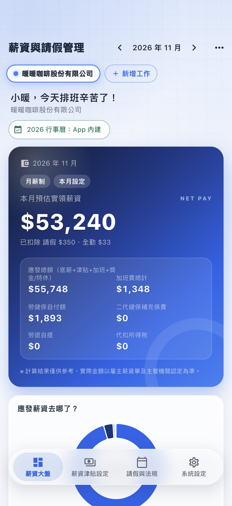 | 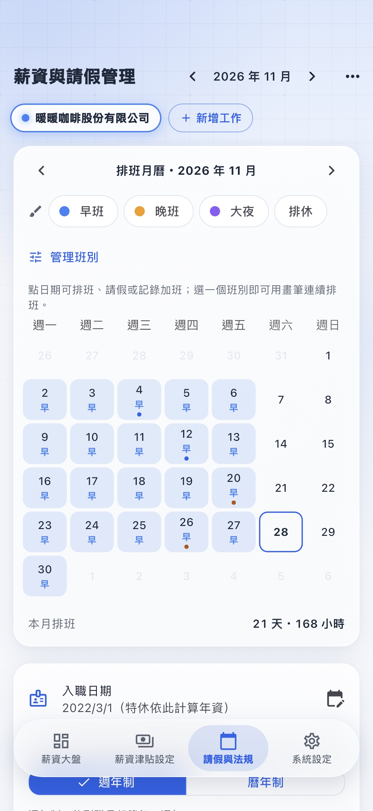 | 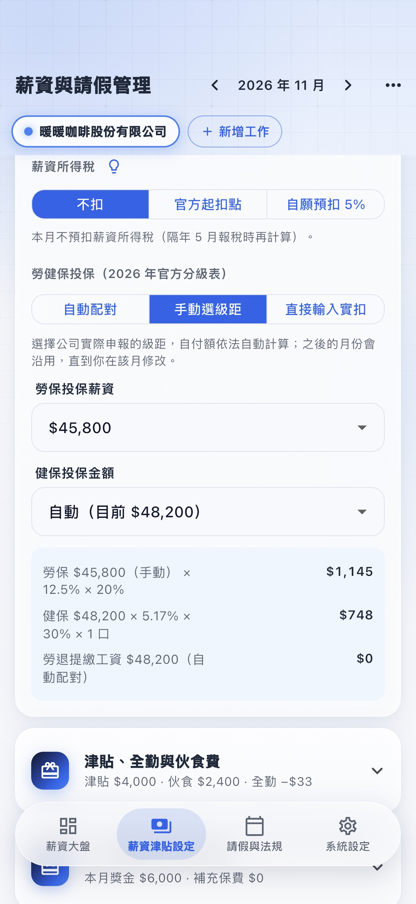 |

| 勞基法照妖鏡 | Premium | 請假紀錄 |
|---|---|---|
| 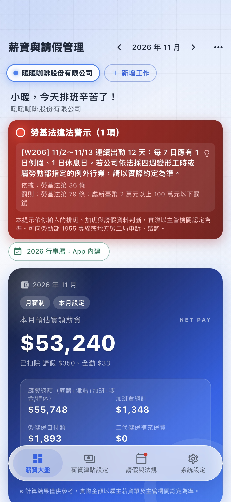 | 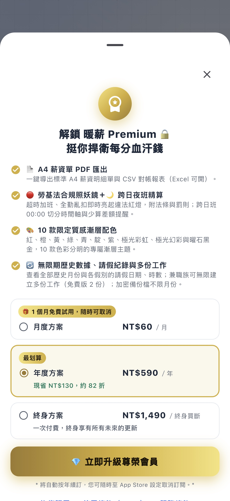 | 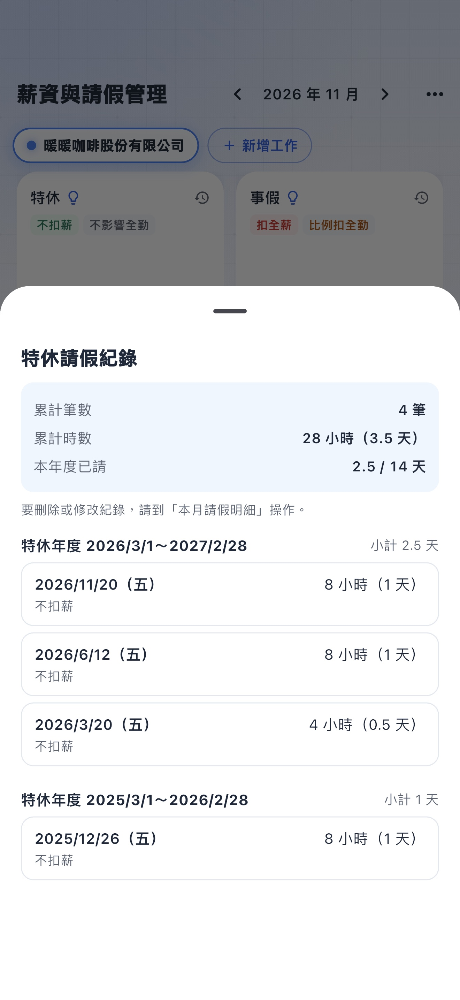 |

| 跨日班精算 | 多份工作 | 功能導覽 |
|---|---|---|
| 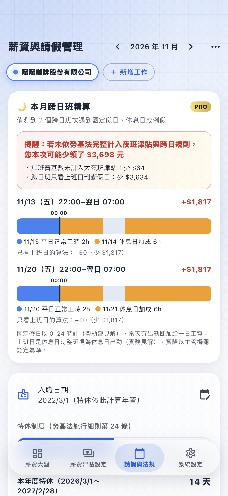 | 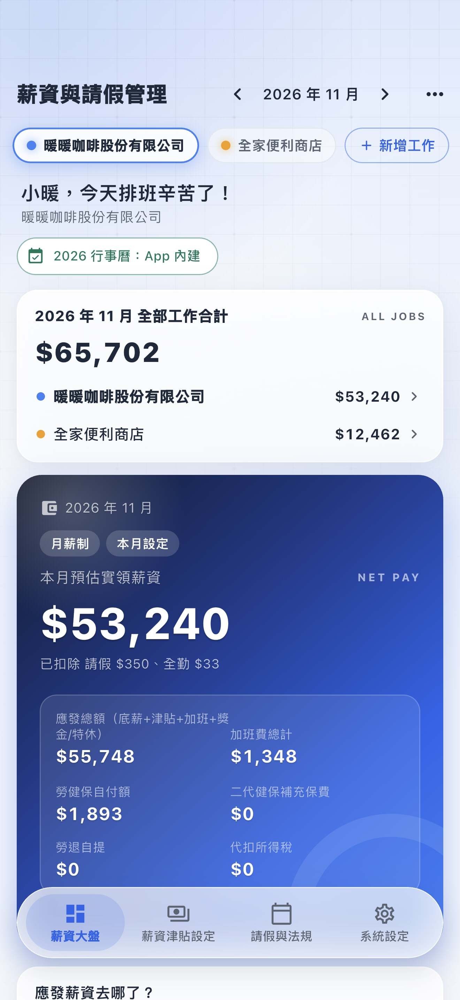 | 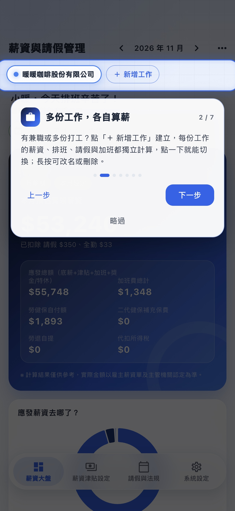 |

| 期間達標獎金 | 單日工時獎金 | 加班費對帳 |
|---|---|---|
| 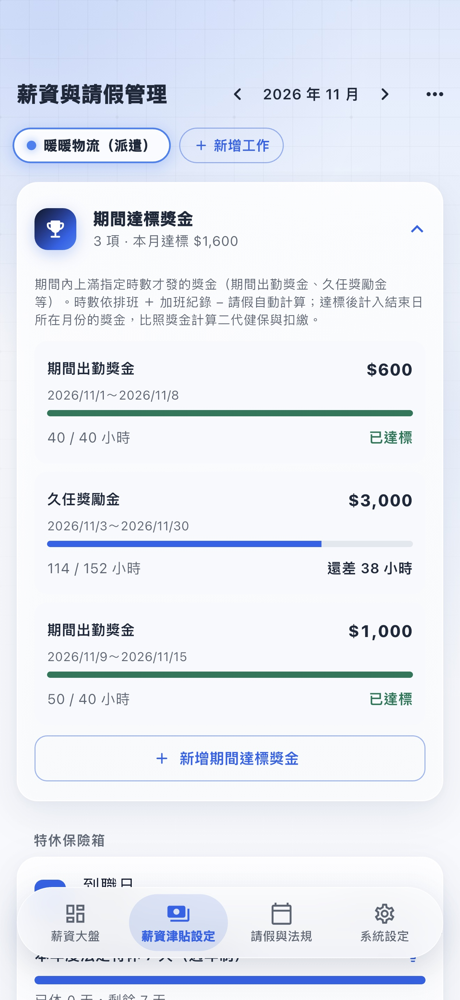 | 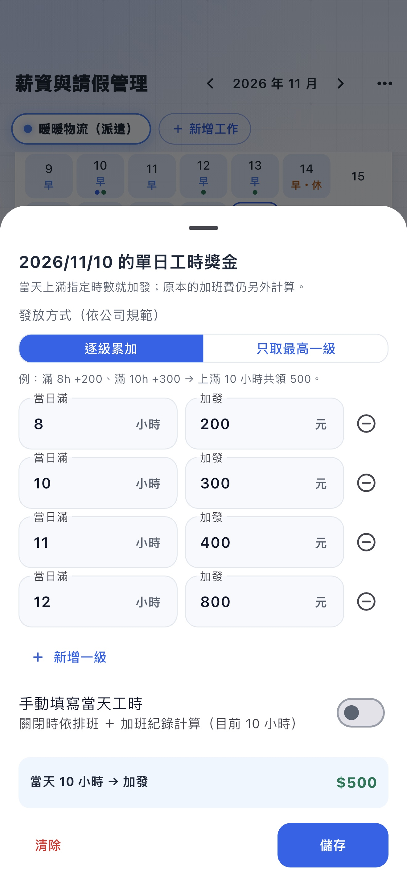 | 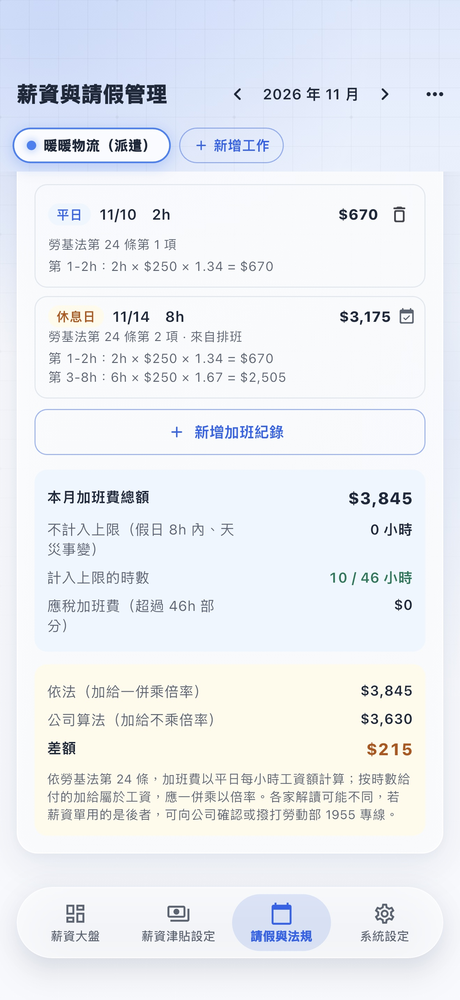 |

| 按件計酬價目表 | 服務紀錄與額外獎金 | 指定率加給 |
|---|---|---|
| 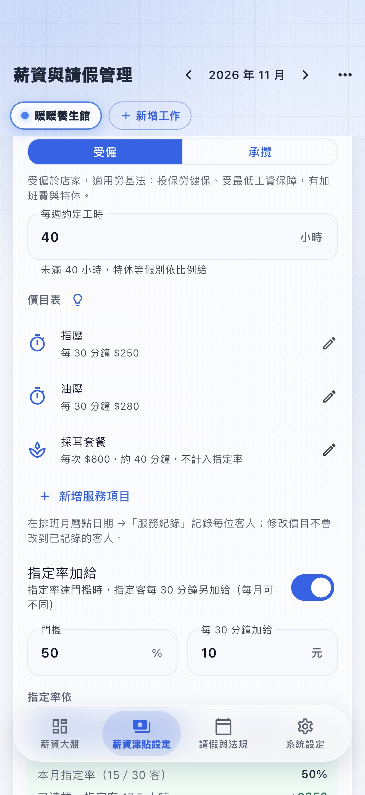 | 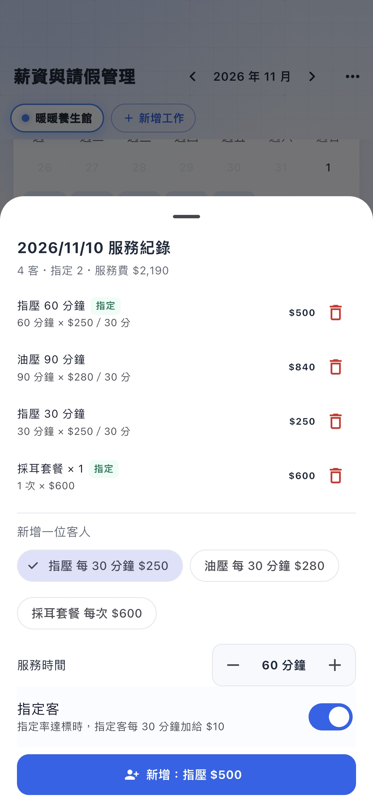 | 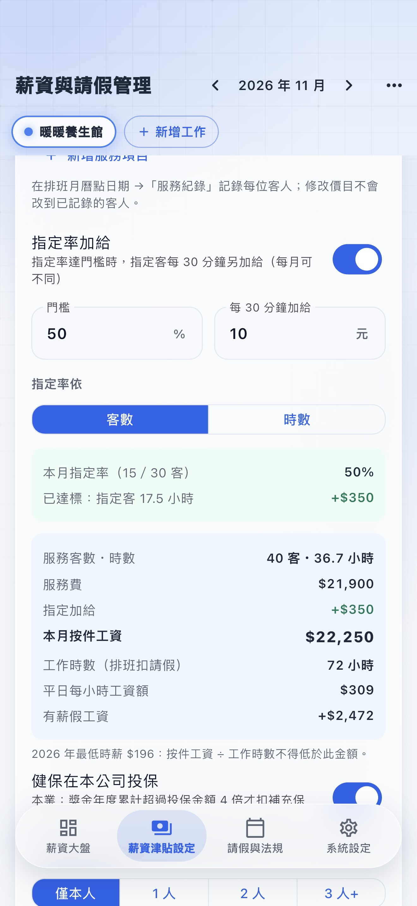 |

（截圖為示範資料，公司名稱為虛構。）

App 預覽影片：[app_preview.mp4](screenshots/app_preview.mp4)

---

## 技術架構

### Flutter 跨平台
- 一套 Flutter（Dart）程式碼同時產出 iOS、Android 與網頁版
- 四個主分頁＋懸浮毛玻璃導覽列；Material 3 主題系統擴充成 14 款漸層配色，每款都通過深淺色的 WCAG 對比檢查
- 動畫只在需要時播放：畫面靜止時不排程任何畫格，以節省電量

### 勞基法計算設計
- **計算核心與畫面分離**：所有法規計算集中在一個純 Dart 的模型層，不依賴任何 UI、網路或檔案，因此每條規則都能用單元測試驗證
- **每月一份帳本**：設定可「沿用到之後的月份，直到修改該月」，符合薪資每月可能調整的實際情況
- **依日期計算工資**：每一天可以有自己的每小時加給，加班費以「當天的平日每小時工資額」乘以倍率；達標獎金由排班、加班與請假紀錄即時推算，不另外存一份可能過期的結果
- **法規資料化、依年度集中**：勞健保費率與級距表、補充保費、扣繳率與起扣點、最低工資、國定假日，集中在單一的年度設定檔，計算時依「結算年度」取用，並註明官方資料來源；最低工資與國定假日可線上更新並加密快取
- **計算沒有副作用**：計算薪資不會修改設定物件（結算年度不同時用副本計算），畫面不會因為「算了一下別的月份」而改變
- **跨日班引擎**：以 00:00 為界切分每一段出勤，分別判斷平日、休息日、國定假日與例假日，再套用各自的倍率
- **按件計酬**：每筆服務紀錄建立時記下當時的單價，之後調整價目表不會改到已發生的薪資；受僱者的平日每小時工資額＝本月按件工資 ÷ 工作時數（勞基法施行細則第 31 條），用來計算加班費、有薪假與最低工資檢查；承攬者改用執行業務所得的扣繳與補充保費規則，並關閉勞基法警示

### 資料加密
- iPhone：系統 Keychain（AES-256）；Android：Keystore 保護的金鑰＋AES-GCM；網頁版：瀏覽器 WebCrypto
- 每個月份、每份工作分開加密儲存
- 加密備份檔：使用者自訂密碼，PBKDF2-HMAC-SHA256（31 萬次）導出金鑰＋AES-256-GCM；金鑰導出在背景執行緒進行，畫面不卡頓
- 正式版程式碼混淆、關閉除錯 log；依 OWASP MASVS 做過自我資安審視

### 資料安全與正確性
使用者的薪資紀錄只存在手機上，沒有伺服器可以幫忙救回，所以「絕不遺失、絕不覆蓋」是最高原則：
- **存檔格式版本與逐版遷移**：每筆存檔都有格式版本號，舊格式讀取時一版一版升級；遇到比 App 新的格式就停下來請使用者更新，不寫入任何資料。新增按件計酬時，內容雖然向下相容，仍把格式升到第 2 版，讓舊版 App 不會在看不懂服務紀錄的情況下把它覆蓋掉
- **損毀資料不覆蓋**：讀不出來時顯示說明畫面（重試、從加密備份還原、以空白資料重新開始），還原或重新開始前都先另存一份副本；單一月份損毀不影響其他月份
- **寫入中斷可復原**：存檔寫到一半當機，下次讀取仍能找回已寫入的月份
- **刪除重裝不默默顯示舊資料**：iOS 刪除 App 後 Keychain 會殘留。以 UserDefaults 的安裝標記判斷「升級」與「重裝」，分不出來時一律詢問使用者，絕不自動清除；iCloud 備份還原不會被誤判
- **錯誤不被吞掉**：存檔、備份、PDF、購買失敗時一定用中文說明並可重試；本機錯誤紀錄只記錯誤類型與程式位置（不記訊息內容，避免夾帶金額或姓名），使用者可自願匯出寄給開發者，不使用任何第三方錯誤回報 SDK

### App 內購買
- Apple StoreKit 2／Google Play Billing：月度、年度訂閱與終身買斷
- 價格、試用期與年繳折扣一律讀取商店資訊，不寫死金額；商店連不上時顯示「重試」
- 支援恢復購買、優惠代碼兌換、付款處理中（例如家長同意）的延遲解鎖
- 已是會員時可在 App 內變更方案（Android 走 Play 換約流程，避免重複扣款）
- **啟動與回到前景時重新確認會員權利**（StoreKit 2 `Transaction.currentEntitlements`／Play `queryPastPurchases`）：訂閱到期或退款就恢復成免費版並說明原因；沒有網路、查詢失敗一律沿用上次結果，絕不誤鎖付費會員；使用者資料一律保留

---

## 開發中遇到的挑戰與解法

| 挑戰 | 解法 |
|---|---|
| **法規改版**：2026 年新版勞工請假規則改變了病假與全勤獎金的關係 | 計算規則集中在模型層，修改一處即可；同步更新 App 內法條說明，並用測試鎖定「病假 1 天、全勤 $3,000 → 最多扣 $100」等案例 |
| **使用者的真實薪資比 App 設想的複雜**：派遣時薪人員有逐時加給、指定日加碼、期間達標獎金與單日分級獎金 | 依使用者回饋重新設計「彈性時薪」：每小時加給跟著每月設定、特定日加給記在月曆上、達標獎金自動計算進度；分級獎金的發放方式各公司不同，所以讓使用者依公司規範選擇，而不是由 App 假設 |
| **公司的加班費算法和法條不一致**：常見「時薪 × 倍率 ＋ 加給」，比法定算法少 | App 依勞基法第 24 條計算，同時列出公司常見算法與差額，並提示可撥打 1955 確認，不直接替使用者下法律結論 |
| **排休的人沒有固定休息日** | 以週一到週日為一週動態判定：只休一天時，第 6 個出勤日視為休息日、第 7 個視為例假，並在月曆上標示 |
| **跨日大夜班**：22:00～06:00 的班跨過午夜，甚至跨進國定假日 | 設計獨立的跨日引擎，以 00:00 切成兩段分別計算，並在少算時提醒使用者 |
| **多份工作要加功能，但不能動到舊使用者的資料** | 主要工作沿用原本的儲存位置，新工作使用獨立命名空間；備份格式升版但仍能還原舊檔 |
| **StoreKit 只告訴 App「有沒有試用資格」，不告訴天數** | 試用標籤與商店後台設定集中在一個常數，並寫進上架檢查清單與測試，避免兩邊不一致被退件 |
| **恢復購買時，交易比商店的「完成」通知晚到** | 商店回覆後再等待一小段寬限時間，一收到交易就提早結束；全程有逾時，不會無限轉圈 |
| **網頁版部署到 GitHub Pages 後白屏** | 修正子路徑 base href、把 CanvasKit 一起打包（不依賴外部 CDN），並加入 404 導回與部署前檢查 |
| **加密備份的金鑰導出讓畫面卡住** | 迭代次數提高到 OWASP 建議值的同時，把運算移到背景 isolate |
| **毛玻璃效果耗電、拖慢捲動** | 全 App 只在導覽列使用即時模糊，其餘卡片以半透明疊層模擬霧面；實測捲動 90% 的畫格繪製在 4ms 內 |
| **讀不出來的資料會被「空白資料」蓋掉**：早期版本讀取失敗時當成沒有資料，使用者一操作就存檔，原本的資料就沒了 | 讀取改為明確區分「沒有資料／損毀／格式太新／暫時讀不到」，後三者完全不寫入；用舊版實際寫出的 Keychain 內容做成固定樣本，驗證讀取、再存檔、再讀取都一筆不差 |
| **刪除 App 後重裝，Keychain 殘留舊資料，但舊版沒留下任何安裝標記** | 找到舊版在 UserDefaults 留下的痕跡（國定假日下載快取）辨識升級；無法區分時一律詢問、主要選項是「恢復」，確保既有使用者不會被誤清資料 |
| **每年改法規數字時，很怕改壞其他計算** | 先建立特性測試：19 組代表性設定 × 4 個月的完整輸出存成基準，再把年度數字搬到單一設定檔；重構後每個金額都必須和基準逐欄相同 |
| **按件計酬的法規和月薪、時薪很不一樣**：受僱與承攬適用完全不同的規則，加班時段做的客人也已經算進服務費 | 先和使用者確認身分、指定率算法與套餐是否計入等規則，再依法條設計：受僱者以平日每小時工資額計算，加班費只另加給加成的部分；承攬者不投保勞健保、改算執行業務所得扣繳。法規解讀可能因個案而異的地方，都在 App 內附上依據並提示以主管機關認定為準 |
| **在已上架的 App 加入全新的薪資制度，不能影響任何舊使用者** | 薪資制度用 enum 搭配 exhaustive switch，新增一種制度時編譯器會列出每一處要補的地方；原本 76 筆特性測試基準逐欄不變，新案例只新增不修改；新舊兩版的存檔都留有固定樣本，確保之後的版本都讀得出來 |
| **使用者要求「額外獎金的算法必須和本月獎金一致」** | 不另寫一套扣稅與二代健保的計算，而是把額外獎金轉成既有的獎金資料型別、送進同一套計算，從結構上保證一致；測試用同一筆金額分別當兩種獎金，比對稅、補充保費、級距、加班費、實領全部相同 |
| **訂閱到期、退款後 Premium 不會關閉**：原本的程式只會解鎖、從不取消 | 改為向商店確認「目前權利」。最難的是邊界情況：只有確定連上商店且查詢成功才取消；查詢途中剛購買時丟棄舊結果；讀套件原始碼發現 Apple 退款會以「已購買」送出被撤銷的交易，因此收到交易後也再確認一次 |
| **想安心重構，卻沒有畫面的安全網** | 加入 golden test：四個分頁「整頁」截圖（先量出整頁高度再拉長畫面）、主要彈窗，涵蓋兩種螢幕、深淺色、1.3 倍字，共 31 張；之後每次修改都必須逐像素相同 |
| **每次畫面重建都重算薪資** | 先量測：比對設定內容的成本只有重算的 1/4～1/80，才加上「設定內容＋年月」快取；並用測試確認任何資料變動都會重算，不會顯示舊金額 |
| **「看起來沒對齊」很難靠肉眼抓** | 寫了對齊稽核測試：自動把四個分頁捲到底，檢查每一列金額、開關、箭頭是否貼齊同一條線 |

---

## 除錯實錄（節錄）

### 1. 「請假與法規」捲到底再捲回來，排班月曆變空白
- **重現**：第一次寫的測試竟然通過。檢查 `git status` 才發現工作目錄已有另一個背景工作改過的程式；改在 `git worktree` 建立的乾淨副本上重現，月曆標題仍是 11 月，格子卻顯示別的月份。
- **根本原因**：讀 `table_calendar` 原始碼，內部 PageView 沒有自己的 key，保存頁碼時與外層清單的 `PageStorageKey('leave')` 共用同一個欄位。月曆被回收重建時，把外層的捲動像素（例如 3000）當成「第 3000 頁」，跳到 2100 年以後。
- **修法**：月曆包在每次重建都全新的 `PageStorage` 裡，一律依目前月份顯示。不採用「讓月曆記住自己的頁碼」，因為月曆不在畫面上時仍可切換月份，會讀回舊月份；這個情況也寫成測試。
- **驗證**：修正前 3 項測試失敗、修正後全部通過；模擬器快速甩動 3 輪；golden 逐像素不變。

### 2. iPhone 數字鍵盤輸入完收不起來
- **根本原因**：iPhone 的數字鍵盤沒有「完成」鍵，Flutter 的輸入框在手機上點外面也不會失去焦點；Android 與網頁沒有這個問題。
- **修法**：在 `MaterialApp.builder` 加一層，iOS 鍵盤打開時在正上方顯示「完成」，並把這一列的高度加進 `viewInsets`，畫面會自動往上讓，不擋住輸入中的欄位；點空白處也能收起。全 App（含底部面板）一次生效。
- **測試**：以 `FakeViewPadding` 模擬鍵盤、`TargetPlatformVariant` 切換平台，驗證 iOS 顯示、Android 不顯示。

### 3. golden 圖在 Mac 通過、在 GitHub 的 Linux 失敗
- **調查**：下載 CI 上傳的差異圖，差異最多 0.11%，集中在斜向光澤紋路與裝飾小點的邊緣；兩邊 31 張的尺寸完全相同，代表排版一致。
- **決定**：不放寬誤差（會漏掉 1 像素的真實跑版），改為 Mac 與 Linux 各存一套基準圖，兩邊都逐像素比對；CI 提供手動按鈕在 Linux 產生新的基準圖。

---

## 測試方式

- **單元與畫面測試：1,000 項以上**，每次提交與部署前都必須全部通過；覆蓋率約 93%
  - 勞基法計算：加班倍率、請假扣薪、全勤比例扣減、勞健保級距、二代健保、所得稅、特休年資、跨日班
  - 彈性時薪：以使用者回饋的實際數字建立測試案例（例如時薪 210＋加給 40 的加班 1 小時應為 335、公司算法 321.4；上滿 12 小時的分級獎金逐級累加 1,700、取最高 800）
  - 按件計酬：以使用者回饋的價目建立案例（指壓 60 分鐘 $500、油壓 30 分鐘 $280、套餐按次計價；指定率 60% 達標時只有指定客每 30 分鐘 +$10，59% 不加給；依客數與依時數兩種算法；承攬 $30,000 扣繳 $3,000、補充保費 $633）
  - 畫面：7 種手機尺寸 × 1.0／1.3 倍字體捲到底不溢位；14 款主題 × 深淺色對比度
  - 購買流程：付款成功、取消、處理中、掉單補發、恢復購買、兌換代碼（以模擬商店測試）
  - 備份：加密、解密、密碼錯誤、新舊格式相容
  - **畫面 golden test**：四個分頁整頁與主要彈窗共 31 張 × Mac／Linux 兩套，逐像素比對
  - **會員權利**：購買、續訂、到期、訂閱與終身方案退款、沒有網路、查詢逾時、查詢途中購買、恢復購買
  - **特性測試**：22 組代表性設定（月薪、時薪、按件計酬、各類加班、跨日班、國定假日、各假別、全勤、勞健保、所得稅、多份工作）× 4 個月，每個金額、警示代碼、每段加班金額都必須與基準完全相同，用來保護重構與每年的法規更新
  - **舊資料相容**：存檔格式已升到第 3 版；以第 1、2 版實際寫出的存檔與加密備份檔作為固定樣本，驗證讀取、讀取後再存檔、損毀與寫入中斷的情境，以及舊版 App 讀到新格式時會停下來
  - **錯誤情境**：以會失敗的假儲存、假商店模擬存檔失敗、檔案損壞、付款失敗，確認使用者看得到說明並能重試
  - **安裝狀態**：全新安裝、從舊版升級、刪除後重裝、iCloud 備份還原
- **模擬器整合測試**：在 iPhone 模擬器上以真實字型逐頁檢查版面並自動產生商店截圖
- **效能與耗電測試**：量測捲動時的畫格時間；確認每個分頁靜止後不再排程畫格；切換分頁、開關付費牆各 50 次的壓力測試
- **持續整合與部署**：每個分支與 PR 都在 GitHub Actions 跑靜態分析、全部測試（含 golden）與覆蓋率摘要；推送到主分支後通過才部署網頁版
- **實機手動測試清單**：刪除重裝、iCloud 還原、舊版升級等只能在實機確認的情境，每次送審前用 TestFlight 逐項驗證

---

## 使用技術

Flutter · Dart · Material 3 · StoreKit 2 · Google Play Billing · iOS Keychain · Android Keystore · WebCrypto · AES-GCM · PBKDF2 · PDF 產生 · 本機通知 · GitHub Actions · GitHub Pages

---

## 聯絡

歡迎透過 Instagram [@warmwage.app](https://www.instagram.com/warmwage.app/) 與我聯絡、回饋建議。

---

※ 本 App 計算結果僅供個人對帳參考，實際薪資以雇主發放之薪資單及相關法令為準。
