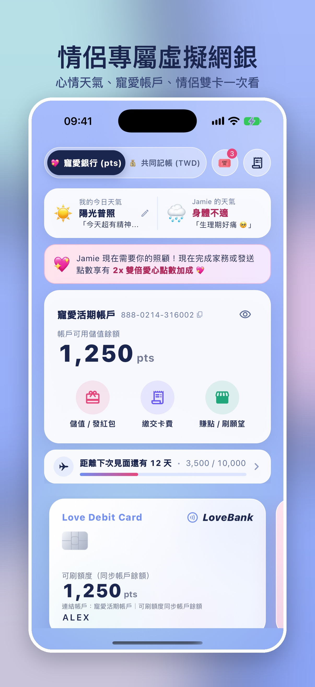

# App 作品集

個人獨立開發的 Flutter App。每個作品都從需求訪談、法規或規則查證、設計、開發、測試一路做到上架與上線後的監控。

本 repo 是作品集展示用，**不包含原始碼**。

---

## 暖薪 Warmwage

> 你的薪水，真的算對了嗎？——依台灣《勞動基準法》幫勞工試算實領薪資、加班費與請假扣款。

| | |
|---|---|
|  | **類型**：薪資試算工具（iOS／Android／網頁）・**已上架 App Store**  **重點**：月薪、時薪、按件計酬與公務人員四種計薪制度；即時計數器與鎖定畫面小工具；自訂計薪週期與公司加班費率；跨日班引擎；勞健保、二代健保、所得稅依官方費率；資料只加密存在使用者手機  **技術**：Flutter · 純 Dart 計算核心 · WidgetKit · AES-256-GCM 加密備份 · RevenueCat · Supabase 營運監控 · GitHub Actions  **測試**：1,330 項以上單元與畫面測試、golden test 逐像素比對  📲 [App Store 下載](https://apps.apple.com/tw/app/id6833072790)　👉 [看完整介紹](warmwage/README.md) |

---

## LoveBank 情侶專屬虛擬網銀

> 做家務賺寵愛幣、刷情侶信用卡兌換願望——把伴侶之間的分工與約定，做成一間只屬於兩個人的虛擬銀行。

| | |
|---|---|
|  | **類型**：雙人即時同步的情侶互動 App（iOS＋Android，中英雙語）・**已上架 App Store**  **重點**：情侶雙卡與信用評分、首頁招財寵物、愛情小法庭、約會賓果、定存生利息、心情天氣 2x 照顧加倍、時光膠囊、異地時差、多國幣別、旅行記帳專案與部分還款、桌面小工具  **技術**：Flutter · Riverpod · Supabase（RLS、Realtime、pg_cron、Edge Functions）· APNs／FCM · RevenueCat · WidgetKit  **測試**：資料庫回滾測試（不留痕跡地驗證權限與金流）、模擬器中英文截圖檢查、上線後購買監控  👉 [看完整介紹](lovebank/README.md)　📱 [App Store](https://apps.apple.com/tw/app/id6835877857) |

---

## 兩個作品的對照

| | 暖薪 | LoveBank |
|---|---|---|
| 資料存放 | 只在使用者手機（後端只接收匿名訂閱事件做營運監控） | Supabase 雲端，兩人即時同步 |
| 最大挑戰 | 法規正確性、絕不遺失或覆蓋使用者資料 | 雙人權限與防作弊、點數經濟、時區與即時推播 |
| 內購 | RevenueCat（匿名、免註冊） | RevenueCat（一人訂閱、兩人共享，伺服器驗證） |
| 測試重心 | 計算特性測試、golden test | 資料庫交易回滾測試、權限測試 |

---

## 聯絡

歡迎透過 Instagram [@warmwage.app](https://www.instagram.com/warmwage.app/) 與我聯絡。
