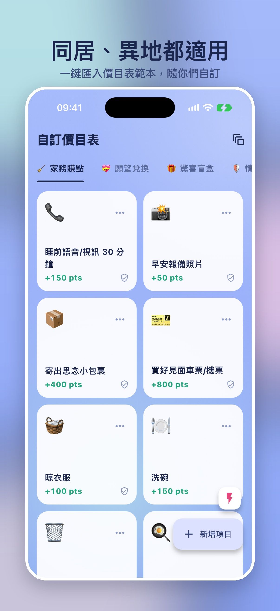
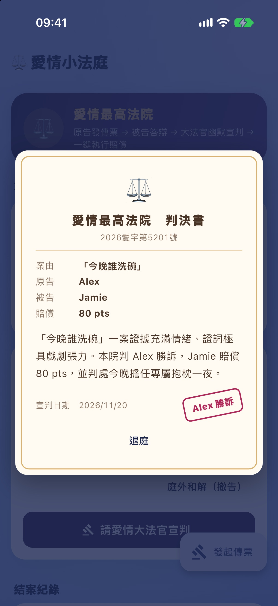
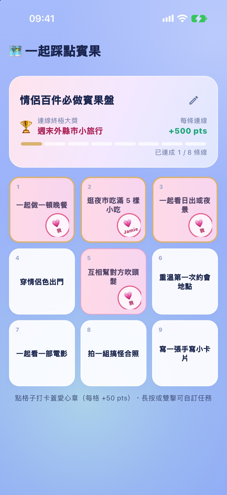
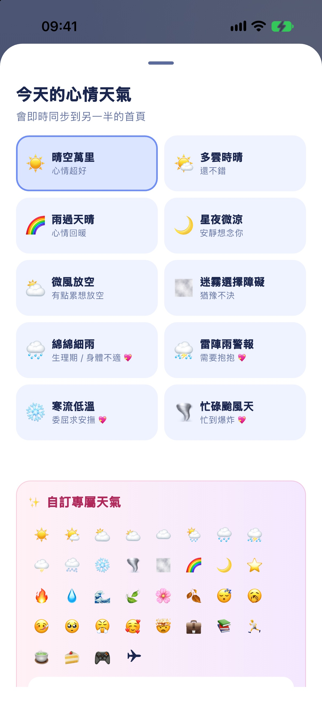
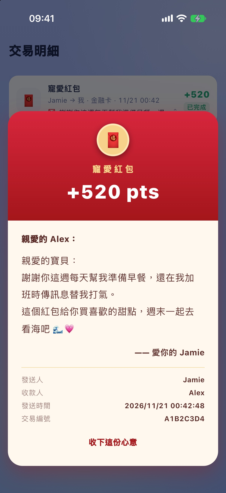
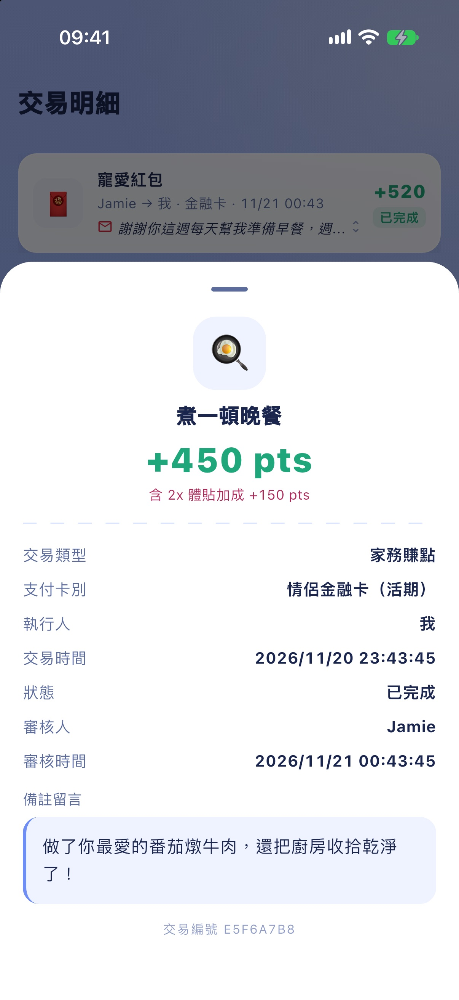

[← 回作品集](../README.md)

# LoveBank 情侶專屬虛擬網銀

> 做家務賺寵愛幣、刷情侶信用卡兌換願望——把伴侶之間的分工、約定與小獎勵，做成一間只屬於兩個人的「虛擬銀行」。

本頁是作品集展示用，**不包含原始碼**。

| 平台 | 連結 |
|---|---|
| App Store | 審查中（上架後補上連結） |
| 隱私權政策 | https://zhi410.github.io/lovebank-legal/privacy.html |
| 服務條款 | https://zhi410.github.io/lovebank-legal/terms.html |

---

## App 簡介

情侶之間常為了「誰做比較多家事」「上次說好的要兌現」吵架，異地或異國的伴侶還有時差與匯率的困擾。

LoveBank 把這些變成一套有儀式感的遊戲：做家務賺點數、經伴侶審核後存進情侶金融卡；伴侶互相核發信用卡額度，刷卡兌換願望；吵架有罰單、和好有保單；兩人一起存「見面基金」。所有畫面即時同步到另一半的手機。

- 兩人各自的手機、各自的語言（繁中／英文），帳務即時同步
- 同居與異地都適用：伴侶當地時間、深夜靜音推播、多國幣別記帳
- 所有點數皆為虛擬點數，不串接任何真實銀行或信用卡

---

## 主要功能

| 類別 | 功能 |
|---|---|
| 寵愛銀行 | 寵愛活期帳戶＋情侶金融卡／信用卡雙卡；家務賺點經伴侶審核入帳；伴侶核發信用額度、每月結帳日與愛情信用評分（準時繳清加分、逾期扣分）；寵愛紅包（附多行祝福語）；Love Pay 感應刷卡動畫與 Face ID 模擬付款 |
| 審核與明細 | 審核中心（紅點＋推播）；交易明細採 keyset 分頁；點擊任一筆彈出詳情收據卡，紅包顯示為紅包信箋並完整呈現留言 |
| 心情天氣 | 10 種天氣情境＋完全自訂（Emoji、名稱、心情小語）；開啟「需要伴侶照顧」光環後，伴侶 24 小時內做家務或發紅包享 2x 點數（每日上限防濫用） |
| 互動樂園 | **愛情小法庭**：發傳票→答辯→伺服器公平隨機宣判＋幽默判決書→一鍵執行賠償；**一起踩點賓果**：3x3 約會任務打卡蓋章，8 條連線各有獎勵、首條連線解鎖大獎兌換券；**定期定額生利息**：7 天 +5%、30 天 +15%，即時倒數、到期領本息、提前解約只退本金 |
| 驚喜與和好 | 愛情盲盒刮刮樂（手指刮開銀漆、可用信用卡付款）、每日幸運刮刮樂、票券夾、情緒保單與吵架罰單、時光膠囊（未到解鎖時間連寄件人都看不到內容） |
| 異地／異國 | 伴侶當地時間；收件人深夜時推播自動靜音送達；見面倒數夢想金庫；多國幣別記帳與匯率換算 |
| 共同記帳（VIP） | AA 平分、自訂比例、全額代墊、一鍵結清；自訂分類與月統計 |
| 月結與分享 | 每月愛情對帳單（家務冠軍、最常兌換的願望），生成 9:16 海報分享限時動態 |
| iPhone 小工具 | WidgetKit 桌面小工具：活期餘額、伴侶當地時間、見面倒數 |
| 帳號與安全 | Email 或 Sign in with Apple；刪除帳號時一併撤銷 Apple 授權；資料安全說明頁 |
| 體驗細節 | 一筆畫玫瑰金愛心載入動畫、全螢幕彩帶慶祝、聚光燈功能導覽（集中在「我的 › 導覽教學」）、iPad 版面 |

---

## 截圖

| 首頁 | 每日刮刮樂 | 票券夾 |
|---|---|---|
|  |  |  |

| 時光膠囊 | Love Pay 刷卡 | 價目表 |
|---|---|---|
|  |  |  |

| 情緒保單 | 共同記帳 | 月結對帳單 |
|---|---|---|
|  |  |  |

| 桌面小工具 | 互動樂園 | 愛情小法庭 |
|---|---|---|
|  |  |  |

| 愛情最高法院判決書 | 一起踩點賓果盤 | 定期定額生利息 |
|---|---|---|
|  |  |  |

| 10 種心情天氣＋自訂 | 紅包信箋 | 交易詳情收據 |
|---|---|---|
|  |  |  |

| 一筆畫愛心載入動畫 | 聚光燈功能導覽 | |
|---|---|---|
|  |  | |

（截圖為示範資料。）

---

## 技術架構

### Flutter ＋ Riverpod
- 一套 Flutter（Dart）程式碼；狀態管理使用 Riverpod 3，資料以 Realtime stream 驅動畫面，伴侶的操作即時出現在自己的手機上
- 中英雙語：每位使用者各自選語言；推播依收件人的語言輸出，判決書等伺服器產生的文字依操作者的語言輸出
- 動畫全部用 `CustomPainter` 自繪：一筆畫愛心（`PathMetric.extractPath`）、刮刮樂銀漆、彩帶、賓果蓋章；不使用任何動畫圖檔
- iPad：內容寬度上限 640，避免卡片被拉長

### Supabase 後端
- **讀寫分離的權限設計**：所有資料表以 RLS 限定「同一對情侶才能讀」；寫入一律經 `SECURITY DEFINER` 的 RPC，App 無法直接改餘額、指定法庭勝訴方或自己開通 VIP
- **交易一致性**：轉帳、紅包、賠償時依固定順序鎖定雙方帳戶，避免同時互發造成死結；重複點擊「執行判決」不會重複扣款
- **排程與推播**：`pg_cron` 處理每日結帳、保單到期、時光膠囊解鎖、定存到期；資料變動由觸發器經 `pg_net` 呼叫 Edge Function，直接以 ES256 JWT 連 APNs 發送推播，依收件人時區在深夜改為靜音送達
- **Edge Functions（Deno）**：推播、RevenueCat Webhook、訂閱驗證補同步、刪除帳號（含 Sign in with Apple 授權撤銷）
- **錯誤碼設計**：自訂 `LB00x` 錯誤碼對應前端的中英文訊息

### App 內購買（RevenueCat）
- 一人訂閱、兩人共享：任一方訂閱，情侶雙方同時享有 VIP
- **雙重保障**：購買成功瞬間寫入本機快取讓畫面立即解鎖；伺服器另由 Edge Function 自行向 RevenueCat 查詢後寫入（App 傳來的資料一律不採信），失敗自動重試、下次啟動補同步
- **錯誤後先確認**：任何購買錯誤都先重新查詢權益，避免「Apple 已扣款、畫面卻顯示失敗」
- **可觀測性**：購買流程寫入診斷紀錄（含版本號、裝置是否允許購買、商店地區，以及失敗時最近的 StoreKit 原生日誌），不必依賴使用者描述就能定位問題

### iOS 原生整合
- SwiftUI WidgetKit 桌面小工具，透過 App Group 與 `home_widget` 共享資料
- Sign in with Apple、APNs、App Group 的簽署設定與佈建描述檔

### 上架自動化
- 以 App Store Connect API 撰寫腳本：上傳截圖、更新上架文字、把 build 換進送審版本、查詢審核狀態
- 用「預覽 harness」（覆寫資料來源的假 provider）在模擬器上產生中英文、iPhone／iPad 截圖，再自動合成商店圖

---

## 開發中遇到的挑戰與解法

| 挑戰 | 解法 |
|---|---|
| **兩個人共用一個帳本，很怕有人改 App 作弊**：自己加點數、指定法庭勝訴方、自己開通 VIP | 資料表只開放讀取，所有寫入都走伺服器端 RPC 並逐項檢查；法庭勝負與判決書由伺服器隨機產生；VIP 只由 Webhook 與「伺服器自行向 RevenueCat 查詢」寫入。每個模組都寫了「用使用者身分直接改表必須失敗」的測試 |
| **點數經濟會被刷**：雙方互設壞天氣、無限開賓果盤、反覆存定存 | 2x 體貼加倍每人每天上限 1,000 pts；賓果盤九格全滿才能開新的一盤；定存每人最多 5 筆、本金有上下限；所有利率與獎勵由伺服器決定 |
| **異地情侶的「今天」不一樣** | 每日刮刮樂依「使用者自己的時區」決定日期；推播依收件人時區判斷 23:00～07:00 改為靜音（`interruption-level: passive`），早上仍在通知中心看得到 |
| **時光膠囊要「時間到之前連寄件人都看不到」** | 內文另存在一張 App 完全沒有權限的資料表；時間到且收件人拆封時，才由伺服器寫回可讀欄位；推播也一律移除內文 |
| **已上架的舊版 App 還在使用中，伺服器卻要改函式** | 新參數一律給預設值（例如盲盒付款方式預設金融卡、心情天氣的新欄位）；Postgres 函式改簽名時先 `drop` 再建立，避免多載造成舊版呼叫時「無法判斷要用哪一個」；以「舊版的具名參數呼叫」寫成測試 |
| **同一筆交易裡的兩個時間戳記完全相同**：開罰單與理賠在同一個 transaction 內，`now()` 回傳同一個值，判斷先後失敗 | 改用 `clock_timestamp()` 並以嚴格大於比較 |
| **自訂錯誤碼和 Postgres 內建的撞號**：拿 `P0004` 當自訂錯誤，結果它是 `assert_failure` | 改用 `LB001`～`LB005` 自訂 SQLSTATE，前端依錯誤碼對應中英文訊息 |
| **推播點進去的頁面和底下的頁面重疊** | App 的背景是全域極光漸層，頁面 Scaffold 為透明；一般 `MaterialPageRoute` 轉場時兩頁同時可見。寫了專用的 `auroraRoute`，轉場時新頁面自帶背景 |
| **審核帳號一直有人登入，但開發者說不是自己** | 查登入紀錄的 IP：除了建立帳號時的兩筆，全部來自 `17.0.0.0/8` 與 `139.178.128.0/18`，查 WHOIS／RIPE 皆屬 Apple——是 TestFlight 外部測試審查與 App Review。據此在審核備註補上沙盒帳號的說明 |
| **送審期間不能換 build，但新功能已完成** | 新功能只上傳 TestFlight、不換進送審版本；伺服器端的改動先確認與送審中的舊 build 相容（舊版仍能設定心情、2x 加倍照常運作，看不懂的新天氣只顯示「還沒設定」） |

---

## 除錯實錄（節錄）

### 1. 輸入 Apple 密碼後「沒有反應」
- **第一步，先看資料而不是猜**：資料庫顯示同時段其他人的 `INITIAL_PURCHASE` 都正常，RevenueCat 也查得到有效訂閱，代表商品與驗證設定沒問題；這位測試員在 RevenueCat 上連一筆交易紀錄都沒有，代表 Apple 根本沒有成立交易。
- **加上可觀測性**：購買流程寫入診斷紀錄，並用 `Purchases.setLogHandler` 把最近 80 行 StoreKit 原生日誌附在失敗紀錄裡。下一次重現時清楚看到：付款視窗開了 13 秒後被關閉，StoreKit 回報 `userCancelled`，之後出現 `StoreKitInternalError.noAccount`——裝置根本沒有登入 App Store。
- **修法**：被系統結束（而非使用者自己按取消）的購買改為顯示說明與「再試一次」；方案載不出來時提示到「媒體與購買項目」登入；同一台裝置連續兩次被取消時改用 StoreKit 1 相容模式。

### 2. Apple 已扣款，畫面卻顯示「購買失敗」
- **線索**：Webhook 收到 `INITIAL_PURCHASE`、情侶已是 VIP，App 卻顯示失敗。
- **根本原因**：購買後呼叫的同步 RPC 在正式環境刻意關閉（防止使用者自己開通 VIP），而購買只要拋出任何錯誤就直接顯示失敗，從不回頭確認。
- **修法**：任何錯誤都先「同步交易 → 重新查詢權益」；VIP 改由新的 Edge Function 向 RevenueCat 查詢後寫入；權益設定若漏掛某個商品，也以商品 ID 判定，避免年訂閱付款後解鎖不了。

### 3. 註冊一直出現「操作過於頻繁」
- **調查**：Supabase 內建寄信服務每小時只能寄 2 封，註冊需要驗證信時很快就達上限；另外發現 Sign in with Apple 帶回的完整姓名可能超過 30 字，觸發資料表的長度限制讓建立 profile 失敗。
- **修法**：調整註冊流程與驗證設定；`handle_new_user` 依序嘗試 display_name、full_name、姓名組合、Email 前綴，截斷到 30 字，任何例外都退回預設名稱，註冊絕不因暱稱失敗。

### 4. 截圖才看得到的問題
- 英文版每日刮刮樂標題溢位、賓果打卡章蓋住任務文字、判決書案號重複顯示——單元測試都通過，是用預覽 harness 在模擬器批次截圖時發現的。之後每個新畫面都會用中英文各截一次再交付。

---

## 測試方式

- **資料庫回滾測試**：每個伺服器模組各一份 SQL 測試，在交易中建立假使用者、走完整流程，最後一定 `raise exception` 讓所有變更回滾，正式資料庫不留任何痕跡。涵蓋：
  - 權限：其他情侶讀不到、App 不能繞過 RPC 直接改表
  - 金流：紅包、法庭賠償（活期不足改刷信用卡）、定存本息（1,000 → 1,050／1,150）、盲盒信用卡付款與額度不足
  - 規則：賓果 8 條連線與大獎券、2x 加倍的每日上限與開關、時光膠囊解鎖時間
  - 相容：舊版 App 的呼叫方式仍可用
- **Flutter 單元測試**：購買錯誤解析與中文說明、VIP 權益判定（含權益漏掛時的商品後備）、多幣別與時區、登入錯誤訊息
- **模擬器截圖檢查**：所有新畫面以假資料在模擬器截圖，中英文各一次，檢查溢位與遮擋
- **實機 TestFlight**：內購、推播、Sign in with Apple、桌面小工具等只能在實機確認的項目
- **上線後監控**：背景腳本每 2 分鐘檢查購買紀錄與「已付款但未開通 VIP」的不一致，有異常立即分析

---

## 使用技術

Flutter · Dart · Riverpod · Supabase（PostgreSQL、RLS、Realtime、pg_cron、pg_net、Edge Functions / Deno）· RevenueCat · StoreKit · APNs · Sign in with Apple · SwiftUI WidgetKit · App Group · App Store Connect API · GitHub Pages

---

※ LoveBank 為情侶互動娛樂工具，並非銀行或任何金融機構。App 內的寵愛幣、金融卡、信用卡與額度皆為虛擬點數，不具任何現金價值。
